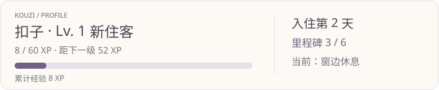
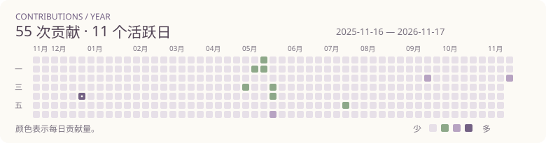
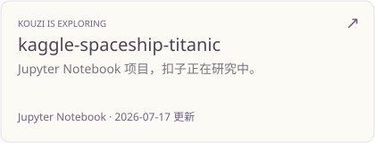
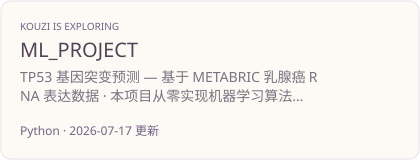

# William & 扣子

写点代码，也养一只叫 **扣子** 的小猫。

<picture>
  <source media="(prefers-color-scheme: dark)" srcset="./assets/kouzi-room-dark.svg">
  
</picture>

<picture>
  <source media="(prefers-color-scheme: dark)" srcset="./assets/kouzi-passport-dark.svg">
  
</picture>

> 🐾 扣子的今日便签：键盘可以让一点位置给猫吗？

## 最近的猫爪印

<picture>
  <source media="(prefers-color-scheme: dark)" srcset="./assets/kouzi-footprints-dark.svg">
  
</picture>

今天 **3** 次贡献 · 今日已记 **5 XP** · 吃饱了，正在陪你写代码

🌱 翻开全年猫爪花园

<picture>
  <source media="(prefers-color-scheme: dark)" srcset="./assets/kouzi-garden-dark.svg">
  
</picture>

每一格是一天，颜色越深，留下的贡献越多。完整日期与活动也能在主页下方的 GitHub 原生贡献区查看。

## 扣子的收藏册

| 收藏章 | 解锁条件 | 状态 |
| :--- | :--- | :--- |
| 入住纪念 | 扣子住进主页 | 🐾 已收藏 |
| 第一口小鱼 | 累计获得 5 XP | 🐾 已收藏 |
| 三日搭子 | 领养后有 3 个活跃日 | ○ 等待点亮 |
| 一周脚印 | 领养后有 7 个活跃日 | ○ 等待点亮 |
| 书架管理员 | 拥有 3 个公开原创项目 | 🐾 已收藏 |
| 键盘学徒 | 成长到 Lv.2 | ○ 等待点亮 |

🎁 翻一翻今天的纸箱

选一个纸箱打开看看；每天换一组小故事。

📦 第 1 个纸箱

纸箱里只有一张纸条：「扣子刚从这里路过。」

📦 第 2 个纸箱

扣子在这里睡着了。轻一点，别吵醒它。

📦 第 3 个纸箱

你翻到一团会滚走的毛线。扣子宣布：今天的宝藏就是它了！

## 扣子正在研究的项目

新项目会自动入架；没有简介时，扣子会根据主要语言写一句通用介绍。

<table>
<tr>
<td>
<picture>
  <source media="(prefers-color-scheme: dark)" srcset="./assets/project-1-dark.svg">
  
</picture>
</td>
<td>
<picture>
  <source media="(prefers-color-scheme: dark)" srcset="./assets/project-2-dark.svg">
  
</picture>
</td>
</tr>
<tr>
<td>
<picture>
  <source media="(prefers-color-scheme: dark)" srcset="./assets/project-3-dark.svg">
  
</picture>
</td>
<td>
<picture>
  <source media="(prefers-color-scheme: dark)" srcset="./assets/project-4-dark.svg">
  
</picture>
</td>
</tr>
</table>

📚 展开全部公开仓库与技术零食柜

| 项目 | 技术 | 最近推送 | 简介 |
| :--- | :--- | :--- | :--- |
| William-331 | Python | 2026-11-17 | William and Kouzi — a little cat home that grows with GitHub contributions. |
| William-331.github.io | HTML | 2026-09-14 | HTML项目，扣子正在研究中。 |
| hk-stock-trading | TypeScript | 2026-09-14 | TypeScript项目，扣子正在研究中。 |
| ML&#95;PROJECT | Python | 2026-07-17 | Python项目，扣子正在研究中。 |
| kaggle-spaceship-titanic | Jupyter Notebook | 2026-07-17 | Jupyter Notebook项目，扣子正在研究中。 |

**技术零食柜**：HTML · Jupyter Notebook · Python · TypeScript

## 猫咪巡逻日志

| 日期 | 扣子记下的事情 |
| :--- | :--- |
| 2026-11-17 | William-331/William-331 · 完成了 2 次提交 |
| 2026-11-17 | William-331/William-331 · 开始了新项目 |
| 2026-09-15 | William-331/William-331.github.io · 完成了 4 次提交 |
| 2026-09-14 | William-331/hk-stock-trading · 完成了 3 次提交 |
| 2026-09-01 | William-331/hk-stock-trading · 完成了 1 次提交 |

📖 翻看更早的巡逻记录

| 日期 | 记录 |
| :--- | :--- |
| 2026-08-28 | William-331/hk-stock-trading · 完成了 1 次提交 |
| 2026-07-31 | William-331/hk-stock-trading · 完成了 1 次提交 |
| 2026-07-27 | William-331/hk-stock-trading · 完成了 1 次提交 |
| 2026-07-24 | William-331/hk-stock-trading · 完成了 1 次提交 |
| 2026-07-17 | William-331/kaggle-spaceship-titanic · 完成了 1 次提交 |
| 2026-07-17 | William-331/ML&#95;PROJECT · 完成了 1 次提交 |
| 2026-07-17 | William-331/kaggle-spaceship-titanic · 开始了新项目 |
| 2026-07-14 | William-331/hk-stock-trading · 完成了 5 次提交 |
| 2026-07-13 | William-331/hk-stock-trading · 完成了 1 次提交 |
| 2026-07-05 | William-331/hk-stock-trading · 完成了 1 次提交 |
| 2026-07-02 | William-331/hk-stock-trading · 完成了 2 次提交 |
| 2026-06-26 | William-331/hk-stock-trading · 完成了 8 次提交 |
| 2026-06-25 | William-331/hk-stock-trading · 完成了 6 次提交 |
| 2026-06-24 | William-331/hk-stock-trading · 完成了 1 次提交 |
| 2026-06-23 | William-331/hk-stock-trading · 完成了 1 次提交 |

🧶 成长与猫窝装饰怎么解锁？

GitHub 每日贡献会自动结算：0 次 → 0 XP，1–3 次 → 5 XP，4–9 次 → 8 XP，10 次以上 → 10 XP。每 60 XP 升一级，领养前的历史不补发经验；休息不扣分。

| 等级 | 猫窝的新变化 |
| :--- | :--- |
| Lv.1 | 纸箱与小碗 |
| Lv.2 | 地毯、毛线球与绿植 |
| Lv.4 | 窗边坐垫 |
| Lv.6 | 仓库守护猫纪念画 |

当前已解锁：纸箱与小碗。

领养于 2026-11-17 · 最后同步 2026-11-17 · 每天自动更新，GitHub 数据可能延迟。公开数据视角，与登录后看到的贡献数可能不同。
