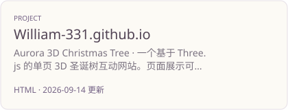
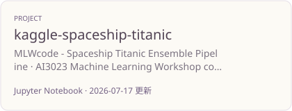
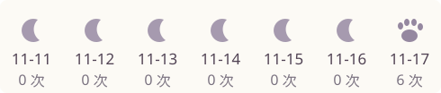

# I build things. 扣子负责监工。

你好，我是 William。写点代码，也养一只叫 **扣子** 的小猫。

<picture>
  <source media="(prefers-color-scheme: dark)" srcset="./assets/kouzi-room-dark.svg">
  
</picture>

**扣子 · Lv. 1 初来乍到**  
今天在晒太阳，等你回家。本级经验 **0/60 XP**，再攒 60 XP 就能升级。

[🐟 喂扣子](<https://william-331.github.io/William-331/?action=feed>) · [🧶 陪它玩](<https://william-331.github.io/William-331/?action=play>) · [🌙 一起休息](<https://william-331.github.io/William-331/?action=sleep>)

休息不掉级。你忙的时候，它就在家晒太阳。

## 扣子最近在研究什么

<!-- AUTO-GENERATED: repository metadata, never edit individual project cards. -->

<a href="https://github.com/William-331/William-331.github.io"><picture>
  <source media="(prefers-color-scheme: dark)" srcset="./assets/project-1-dark.svg">
  
</picture></a>
<a href="https://github.com/William-331/hk-stock-trading"><picture>
  <source media="(prefers-color-scheme: dark)" srcset="./assets/project-2-dark.svg">
  
</picture></a>
<a href="https://github.com/William-331/kaggle-spaceship-titanic"><picture>
  <source media="(prefers-color-scheme: dark)" srcset="./assets/project-3-dark.svg">
  
</picture></a>
<a href="https://github.com/William-331/ML_PROJECT"><picture>
  <source media="(prefers-color-scheme: dark)" srcset="./assets/project-4-dark.svg">
  
</picture></a>

自动展示最近更新的项目；给仓库添加 `kouzi-featured` Topic 可优先展示。

## 一起长大

<picture>
  <source media="(prefers-color-scheme: dark)" srcset="./assets/kouzi-footprints-dark.svg">
  
</picture>

从 **2026-11-17** 开始一起生活，累计 **0 XP**。  
**初来乍到** → **键盘学徒** → **代码搭子** → **仓库守护猫**

已解锁：纸箱与小碗。

扣子是怎么长大的？

| 当日贡献数 | 经验 |
| --- | --- |
| 0 | 0 XP，安心休息 |
| 1–3 | 5 XP |
| 4–9 | 8 XP |
| 10 或更多 | 10 XP |

每级 60 XP；每天最多 10 XP，同一天重复同步不会重复加分。贡献只从领养日起计入，已获得的经验不会因休息或后续贡献修订而扣除。

等级 2 解锁猫窝、毛线球和绿植；等级 4 解锁窗边坐垫；等级 6 解锁纪念画。独立猫窝里的喂食和玩耍只改变本机互动状态，不增加真实经验。

数据同步：2026-11-17 · 按 GitHub 贡献日历统计 · 每日自动更新，可能有延迟。

[GitHub](https://github.com/William-331) · [去扣子家坐坐](https://william-331.github.io/William-331/) · [Interactive Experience](https://william-331.github.io/)
